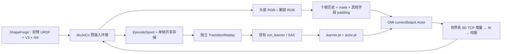

# 双相机 MuJoCo → OMI 视觉训练链路

2026-11-21 已接通 ShapeForge 的真实 URDF 场景与 `omi_proj` 现有视觉 SAC。任务是固定抓取假设下的孔口前到达，完整链路已运行到梯度更新、发布新权重、下一回合使用新权重和进程退出后的续训。

## 职责与执行顺序

采集和学习按回合交替运行，共用现有 OMI 的 `EpisodeSpool`、`FrameWriter`、`TransitionReplay`、`run_learner`、`publish` 和 `load_actor`。不是重新写一套训练算法；本版未接异步采集进程或 cached 双池。独立确定性评估不写 replay。

ShapeForge 的 `sim/vision_scene.py` 从历史机器人场景派生新场景，保留原文件；`sim/vision_env.py` 提供 `DualCameraPreinsertEnv`，工厂名为 `robot_preinsert_vision`。OMI 的 `training/shapeforge_config.py` 定义仿真合同，`training/shapeforge_train.py` 负责训练生命周期。

## 场景与相机

继续使用完整厂商双臂／夹爪、V3 模块、r04 插接座和完整支架。模块成为 TCP 的固定子对象；工具偏移沿局部 Z 为 140 mm，依据导入网格中指部约 Z=74–169 mm 的范围选择，避免把模块放进掌体。这是显式的仿真假设，未标定实际夹持点，也未执行接触抓取。

插接座摆在一个可达目标处，模块名义尖端停在金属口沿外 5 mm；台面高度随支架位置装配。成功条件仍为 TCP 位置误差小于 3 mm、近似旋转误差小于 0.02 rad。关节起点每回合小幅扰动，目标固定；不把图像配准粗解当作现场米制布局。

头部视角固定在机器人基座 `ZJ_Robot_link` 上，腕部视角固定在 `TCP_Link_L` 上。两者均为 MuJoCo 原生针孔相机，128×128 RGB；它们不是已复现实物安装外参／鱼眼畸变的相机。每次控制步结束，对同一个 `mjData` 渲染两张图；两路时间戳相同，步间模拟时间为 100 ms，实际运行可快于实时。

首轮场景分割渲染确认：头部图像可见模块 223 像素、插座 1891 像素；腕部为 791／2666 像素。测试确认头部相机世界位置不动、腕部随末端移动、模块保持工具相对变换、两路像素随运动更新。

## 输入、动作与奖励合同

| 字段 | 形状／类型 | 来源 |
| --- | --- | --- |
| `rgb` | 10×3×128×128，uint8 | 实际头部相机渲染 |
| `wrist_rgb` | 同上 | 实际腕部相机渲染 |
| `camera_mask` | 10×2，float32 | 有效帧为 1，历史 padding 为 0 |
| `history_mask` | 10，uint8 | 最老到当前；不足十帧左补零，reset 清空 |
| `state` | 10×14，float32 | 全零 padding，不含目标／关节／TCP 真值 |
| `tactile` | 10×10×16×24，float32 | 全零 padding，不是已测零接触力 |

没有添加 wrench 输入分支；需要时应新增合同和相应 mask。真值 TCP 只用于 reward／终止／诊断。动作沿用 10 Hz、六维归一化 TCP 增量，平移每轴 `1 mm / √3`、旋转每轴 `1° / √3`，在 MuJoCo 世界坐标中执行。记录请求动作、接受的归一化命令、IK 关节目标和实际末端运动，不能把命令幅度解释成已实现的位移。

奖励为 `20 × (上一步位置误差 − 当前误差) − 0.001 + 成功标记`。成功终止；时限截断并允许 bootstrap。`action_source=policy`，没有把脚本控制冒充人工示范。仿真 observation/action/reward ID 均独立于真机，旧 checkpoint／经验池不会被此入口接受。

网络使用已有 `current9stack`，加载迁移的 SERL ImageNet ResNet10 backbone；没有加载旧任务 BC／RL 策略。骨干冻结，历史 stem、视觉投影、融合与 SAC 头参与已有训练规则。基础 GridProfile 只用于相同张量结构，物理数据语义以新的仿真合同为准。分别遮掉两路 RGB 后策略输出均改变；两路投影、历史 stem 和 Actor 头均有实际参数更新。

## 已验证与边界

正式运行两回合共 200 步，完成 16 次 SAC 更新；独立进程续训一回合后共 300 条经验、20 次更新。Actor 使用版本依次为 0、8、16，发布版本 8、16、20。checkpoint 重新加载后的确定性动作与已发布 Actor 最大差为 0。评估结果是未成功，不能以链路通过声称已学会预插入。

现有状态环境仍保留；新环境接触关闭、重力补偿开启、位置伺服参数未标定。固定附着没有证明夹爪抓取成立，孔口弹片刚体相交问题仍未解决。本轮不宣称接触插入、真实触觉、精确相机复现或 sim-to-real 成功。

产物和启动见[训练教程](../../../../tutorials/dual_camera_training.md)，验证清单为 `manifests/dual_camera_training_20261121.json`。下一步可沿这条链路逐项替换 padding、校准工具／相机、加入接触和任务随机化；每次变更须保存新的场景和数据合同。
