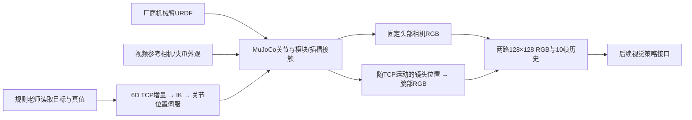

# 视频参考腕部相机与夹爪资产

后续已另存[WG-r05双目参考精修版](wrist-tool-refinement.md)，使用新采集数据修订形状与尺寸，49件并独立导出相机／夹爪。本页旧r04的2/2插入和1.961 mm净空只适用于旧场景，不自动转移到新工具。

后续按用户要求完成[真实夹爪像素＋仿真模块／插槽的单帧预览](hybrid-wrist-preview.md)，使用已有真实腕部帧与用户提供的鱼眼内参。它是独立静态合成实验，尚未替换本页实时场景的观测接口或完成动态映射验证。

2026-11-21，用户希望直接查看仿真过程，并提供`/home/linux/Downloads/飞书20261121-212005.qt`，说明视频中是戴蒙／DAIMON的相机和夹爪。已建立独立外观候选 **WG-DAIMON-VIS-r04**，并接入新的MuJoCo对照场景；原V4-r05模块、SIM-r06插槽、旧机器人场景和训练结果保留。

## 当前仿真实际如何工作

当前窗口演示由规则老师驱动，从已经附着模块的预插入位姿开始，连续执行插入和退出。模块用固定变换附着于工具，并未通过真实夹爪接触抓起。物理步长0.2 ms、控制周期0.1 s；模块／插座／台面／等效触点接触保持开启。状态和触觉观测仍为padding，未生成假的触觉传感数据。

## 视频依据与模型边界

视频约11.425秒，能看到黑色相机壳及短安装座、黑色弯指、橙色蜂窝状内衬、白色指尖组件、金属法兰和绿色线缆。原URDF包含腕部附件和夹指网格，但其尖形夹指外观与视频不一致，未直接当作本视频硬件。

本候选使用本地URDF中72 mm法兰作为尺度参考，其他外形按视频比例估计。尚未确认相机／夹爪的具体型号，也未取得已核对同型号的厂家CAD。官方[DM-Tac G产品资料](https://www.dmrobot.com/devices/dm-tac-g.html)仅作产品背景参考；页面参数不能证明视频中所装版本的尺寸或机构。没有将本地三指外骨骼公开包代替这套双指夹爪。

## 资产组成与坐标

| 组成 | mesh数 | 内容 |
| --- | --- | --- |
| 法兰、驱动外壳、盖板和螺钉 | 9 | 视频外形候选，非厂家内部结构 |
| 相机与安装座 | 5 | 底座、短颈、圆角相机壳、镜框、镜片 |
| 双指及指尖 | 14 | 两侧弯指、橙色内衬、蜂窝细节、白色壳、深色接触面和紧固件 |
| 接头与线缆 | 3 | 局部视觉表示，线缆末端已封口 |

共31个可分开的工具mesh，全部通过闭合性、法向一致、正体积及非退化面检查；GLB重开包络一致。Blender还包含18个V4参考模块mesh用于展示握持关系，**参考模块不属于31件工具，也不导出到工具GLB中**。

工具公共坐标使用米制：原点为TCP法兰参考，+Z朝指尖、+X为相机侧，夹指沿Y方向开合。两侧可见接触面参考间距18.8 mm，对应继承URDF滑动关节的参考q=0.0313 m；这是显示／运动绑定，不是戴盟真实机构或行程标定。橙色内衬与指尖组件只做外观，没有弹性／触觉响应模型；视频附加贴纸与marker未加入。

## 相机不是自由摆放的观察视角

| 项目 | 原测量场景 | 新相机候选场景 |
| --- | --- | --- |
| 腕部相机父节点 | TCP_Link_L | TCP_Link_L |
| TCP下位置 | (100, −60, 70) mm | **(57.73, 0, 65.536) mm** |
| 垂直视场角 | 68° | 90°估计值 |
| 光学位置与外壳关系 | 假设视点，没有与本视频外壳匹配 | 与新镜片几何绑定，位于镜片中心沿前向0.6 mm处，略在外表面之前以避免外壳挡住渲染 |
| 投影模型 | 未标定针孔 | 仍为未标定针孔，未复现真实鱼眼畸变 |

新光学前向在TCP系约为`(-0.45, 0, 0.89303)`，朝向双指中间。相机壳尺寸约32 × 34 × 28 mm为外观估计。安装坐标、方向和鱼眼内参需要后续实测；不能用外部拍摄视频直接当作腕部相机的标定结果。

测试核对了渲染相机的实际位置与模型镜头位置一致；夹指对称移动时相机不随指关节移动。头部与腕部图像和策略观测最后一帧逐像素一致。最终初态分割检查：头部图像有190个模块像素／1891个插座像素，腕部图像有172／494个；两路都能看到目标，未据此宣称特征分辨率或定位精度足够。

## 安装修正与几何干涉检查

新场景保留机械臂关节和原URDF惯量，替换左侧旧工具的可见几何，把新指部件分别绑定到Arm_L10/11_Link，基体和相机绑定到TCP。新工具的碰撞和附加质量暂不开启；现有URDF惯量不是新外观工具的已标定惯量。

为了让模块沿新夹指方向放置，重定义固定工具到模块的旋转，并重新求解预插入TCP姿态。最初参考模块原点距TCP为180 mm，模块接触任务能成功，但独立网格检查发现6个工具部件在到位时与插座／PCB相交。这说明仅看开启的模块／插座接触成功会遗漏工具视觉穿插，该装配未作为最终候选。

最终将固定握持变换调整到TCP的Z=195 mm，工具31件几何保持不变；重新求解IK并同步预插入／到位目标。对名义轴向路径的21个位置检查无工具／插座表面相交，最小距离约 **1.961 mm**；装配状态下工具与模块也无表面相交。该检查是固定开口的名义几何路径，**不是实时夹爪接触或整机自碰撞验收**。

## 已验证结果

- 最终场景种子19／41：规则插入与退出 **2/2通过**，插入182／183步，退出均186步，到位约51.2804 mm。
- 模块／插座接触的逐物理步最大数值侵入约0.00217 mm，触点静态余量保守界最小约0.1130 mm。
- 相机历史连续、头部相机固定、非主动臂保持；两个专门安装测试验证镜头坐标、图像观测一致及夹指对称运动。
- 控制层34项测试通过，其中20项环境可选测试跳过；两个新场景安装集成测试在仿真环境实际通过。
- 原模块、旧场景与各候选输入的哈希核对未变。新相机视角下未重训或评估视觉策略，不能沿用此前旧视角的策略成绩。

## 入口和后续工作

- [工具Blender](/data/omi_runtime/assets/daimon/wrist_gripper_video_r04/WG-DAIMON-VIS-r04.blend) · [工具GLB](/data/omi_runtime/assets/daimon/wrist_gripper_video_r04/WG-DAIMON-VIS-r04.glb)。
- [最终新场景](/data/omi_runtime/runs/wrist_camera_gripper_20261121/robot_scene_final/scene.xml) · [插入／退出视频](/data/omi_runtime/runs/wrist_camera_gripper_20261121/corrected_final_cycle/robot_contact_cycle.mp4)。
- [汇总报告](/data/omi_runtime/runs/wrist_camera_gripper_20261121/report.json) · [命令与交互操作](../../../../tutorials/wrist_camera_gripper.md) · [登记](../../../../manifests/wrist_camera_gripper_20261121.json)。

后续需要具体硬件型号／CAD、真实安装尺寸、鱼眼内外参和工具／夹持变换，再分阶段建立夹爪碰撞、惯量、接触抓取及触觉模型。当前成果是可检查、可挂载并实际输出腕部图像的外观候选，而非厂家CAD或真机数字孪生验收。
