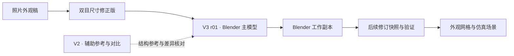

# 光模块资产版本：V3 为主，V2 辅助

2026-11-20 用户确定：**Blender 建模路线命名为 V3，后续重点使用 Blender；V2 作为 V3 的辅助参考和对比。** 正式决定见 [ADR 002](agent/simulation/decisions/002-blender-v3-primary.md)。资产族 `OM-001` 是本地目录编号，厂家型号仍待核实。

## 当前主版本与角色

| 资产版本 | 角色 | 几何来源 |
| --- | --- | --- |
| `OM-001/V3`，当前修订 r01 | 主模型；在 Blender 中编辑、修正与导出 | 当前连通槽 `connected_groove.blend`；旧目录名 `OM-001/GROOVE-r01` 保留为别名 |
| `OM-001/REF-V2`，简称 V2 | 辅助参考与对比，保留历史基线 | 原结构先验结合观测细化的 V2；Blender 参考封装为 `v2_reference.blend` |
| `OM-001/METRIC-r01` | V3 路线的历史尺寸稿 | `stereo_refined.blend`，冻结的双目尺寸估计 |
| `OM-001/PHOTO-r01` | V3 路线的历史照片稿 | `photo_unscaled.blend`，未定标 |

V3 当前工作文件：

[OM-001-V3.blend](/data/omi_runtime/assets/optical_module_v3/work/OM-001-V3.blend)

V3-r01 冻结副本：

[OM-001-V3-r01.blend](/data/omi_runtime/assets/optical_module_v3/releases/r01/OM-001-V3-r01.blend)

本次工作副本、冻结副本与原 `connected_groove.blend` 的初始 SHA256 完全一致。版本命名不包含新几何变更，也不改变 Python 包版本。迁移包原文件、历史 V1／V2／V2.1 和旧验证记录均保留。

V3 的槽结构曾参考 V2，不能将当前整个 V3 称为完全独立于 V2 的建模结果。V2 的作用是提供参考和对照，不自动覆盖 V3 的编辑结果。

## 后续开发约定

1. 默认在 V3 的 Blender 工作副本编辑；冻结副本和迁移原件用于回溯。
2. 可交付的几何修改保存为新的 r02／r03 快照，记录父版本、实际源文件哈希和改动说明。
3. 每个修订重新导出所需 OBJ／MJCF／USD 到新目录，并完成对应检查。工作文件改变后，不把已有场景当作自动同步。
4. 需要 V2 时明确标注“辅助／对比”，保留其原几何和历史报告。

文件、哈希、别名、来源关系和部件名称以[资产登记表](../manifests/optical_assets.json)为准。Blender 打开与导出步骤见[教程](../tutorials/blender_assets.md)。

## 展示与尺寸边界

照片稿和尺寸修正版各有 20 个可见求值部件，V3 有 15 个，V2 参考有 3 个。数量包含曲线求值后的几何，不等于场景中 MESH 类型对象数。显示数据应用对象变换，排除隐藏构造刀具；各模型分别适配显示大小，材质为示意。

| 版本 | 已建部件包围盒 X×Y×Z（mm） |
| --- | --- |
| V3 r01 | 18.79 × 100.37 × 10.45 |
| V2 参考 | 17.36 × 69.44 × 10.38 |
| 历史尺寸稿 | 18.79 × 100.44 × 10.45 |
| 历史照片稿 | 未知物理尺度 |

数值来自模型几何，不是实物测量。V3 包含拉臂，V2 参考没有拉臂，不能直接以 Y 总长度判断壳体精度。V3 的冻结壳体长度估计约 70.19 mm；本次未重新估计尺寸，物理精度仍未验收。

网页查看器保留四版本对照，默认选择 V3，并支持无 WebGL 时的 CPU 后备渲染。Open3D 原生窗口保留为 V2／V1 历史参考工具，见[原生查看教程](../tutorials/native_mesh_viewer.md)。主要建模工具为 Blender。

## 场景实例

既有单模块及 2×2 场景源于与 V3-r01 相同的连通槽几何。本次更新目录关联，不重写历史场景或报告；它们继续是盒碰撞、假设质量／摩擦的原型。

场景 `SC-OM001-ARRAY2x2-r01` 中四个实例共同引用 V3-r01：

| 实例 | 原 MJCF body | 初始 X／Y／Z（m） |
| --- | --- | --- |
| OM-001-I01 | optical_module_0 | −0.06／−0.07／0.055 |
| OM-001-I02 | optical_module_1 | +0.06／−0.07／0.055 |
| OM-001-I03 | optical_module_2 | −0.06／+0.07／0.055 |
| OM-001-I04 | optical_module_3 | +0.06／+0.07／0.055 |

实例身份不依赖相机视角。历史图片和模型文件入口见[可视化目录](visual-results.md)。
