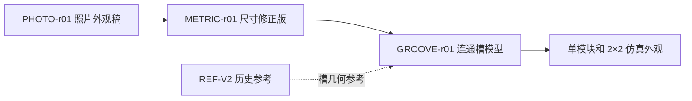

# 光模块资产名称与版本

2026-11-20 建立首批目录编号。资产族 `OM-001` 表示当前光模块建模对象，不是厂家型号；厂家和型号尚未核实。本次给已有源文件建立名称和哈希映射，不重命名原文件，不改变历史 V1／V2／V2.1 含义。

## 模型版本

| 资产版本 | 中文名 | 原文件 | 用途与边界 |
| --- | --- | --- | --- |
| `OM-001/PHOTO-r01` | 照片外观稿 | photo_unscaled.blend | 照片比例建模，未定标，不能读取为真实尺寸 |
| `OM-001/METRIC-r01` | 双目尺寸修正版 | stereo_refined.blend | 使用已冻结的米制尺寸估计；不是本次重新做 59 帧尺寸计算 |
| `OM-001/GROOVE-r01` | 连通槽模型 | connected_groove.blend | 当前外观导出来源，纵槽／横槽连通等深；局部几何参考 V2，槽深等仍非实测 |
| `OM-001/REF-V2` | 历史 V2 参考 | v2_reference.blend | 保留原 V2 名称，只含壳体、接触板和接触区，没有拉臂 |

前三者是建模用途不同的版本；REF-V2 是历史参考支线，不能理解为排在 GROOVE 后面的一次升级。四份模型不是四种已经识别出厂家型号的实物产品。

所有源文件路径、SHA256、父版本、引用关系和原部件名称保存在[资产登记表](../manifests/optical_assets.json)。以后同一建模用途的源文件内容变更才增加 `r02`、`r03`；新版本记录新哈希与父版本，不覆盖旧登记。单纯给图册改标题不增加几何修订号。

## 展示范围与尺寸

本次重新读取原 Blender 文件的求值网格／曲线，应用物体变换，排除隐藏构造刀具；未重新生成模型或修改源文件。照片稿和尺寸修正版分别有 20 个可见求值部件，连通槽 15 个，V2 参考 3 个。此数量包含曲线求值后的几何，不能与先前 `scene_mesh_objects` 的场景网格对象数直接比较。

交互对照分别适配各模型大小，便于看形状，不是同一比例尺。外观材质为示意。显示数据只做中心化、整体缩放和坐标取整，不抽减三角形。光模块模型的精度验收状态没有改变。

查看器现支持无 WebGL 的桌面浏览器：自动改用 CPU 网格渲染，保留旋转、缩放与部件选择。早期带软件 WebGL 的无头测试没有覆盖实际桌面配置；本次已补充对应检查，见[兼容性记录](../manifests/viewer_compatibility_validation_20261120.json)。

| 版本 | 含已建部件的包围盒 X×Y×Z（mm） |
| --- | --- |
| PHOTO-r01 | 未知物理尺度 |
| METRIC-r01 | 18.79 × 100.44 × 10.45 |
| GROOVE-r01 | 18.79 × 100.37 × 10.45 |
| REF-V2 | 17.36 × 69.44 × 10.38 |

上述来自模型几何，不是卡尺测量。前三者包含拉臂，V2 没有拉臂；不能用表中 Y 总长度比较壳体精度。METRIC／GROOVE 的冻结壳体长度估计约为 70.19 mm，其来源和不确定性仍以原数据及能力文档为准。

## 2×2 场景实例

场景中的四个光模块是同一个 `GROOVE-r01` 模型的四个实例，不是四个版本。目录场景编号为 `SC-OM001-ARRAY2x2-r01`，仅建立名称映射，原 MJCF body 名称不变。

| 实例名 | 原 MJCF body | 初始 X／Y／Z（m） |
| --- | --- | --- |
| OM-001-I01 | optical_module_0 | −0.06／−0.07／0.055 |
| OM-001-I02 | optical_module_1 | +0.06／−0.07／0.055 |
| OM-001-I03 | optical_module_2 | −0.06／+0.07／0.055 |
| OM-001-I04 | optical_module_3 | +0.06／+0.07／0.055 |

实例身份不依赖相机看到的“左上／右下”，避免旋转视角后名称反转。后续新场景若需要新增实例，从 I05 继续或使用新的场景命名空间，并显式记录模型版本。

历史原图、场景截图和交互文件见[可视化目录](visual-results.md)；当前能力边界见[资产管线](agent/simulation/evolution/asset-pipeline.md)。

希望使用原电脑的独立桌面窗口时，见[Open3D 原生查看器](../tutorials/native_mesh_viewer.md)。本机已经打开并核对历史 V2／V1 的实际桌面显示。
