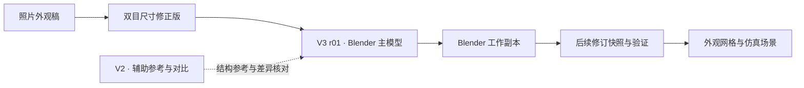

# 光模块资产版本：V4-r05暂定外观基线，历史资产保留

2026-11-25新增独立夹爪候选：[WG-DAIMON-PHOTO-r16](agent/simulation/evolution/wrist-photo-refinement-r16.md)，两侧银壳与橙色材质修订，1920原图／同ROI链核对。r16未自动替代WVA-01／r15，不改变OM-r08、碰撞或训练默认；源版本和试验均保留。[登记](../manifests/wrist_photo_refinement_20261125_r16.json)。

2026-11-25新增组合 [SC-WVA01-ISAAC-FIXTURE-r01](agent/simulation/evolution/wva01-isaac-insertion.md)：WG-r15／OM-r08／当前插座，原UV标志与GC-r01闭合参考，明确固定夹持插入。它是独立Isaac接入身份，不重命名夹爪r16、不改WVA-01清单，不把自由夹持候选记为已验收；单独V4-r05基线身份保留。

> 本机迁移提示（2026-11-24）：运行资源实体已迁至 `/data/shapeforge/runtime`；本文中的 `/data/omi_runtime` 是保留的兼容入口，指向同一份内容。目录映射与恢复要求见[当前资源契约](agent/interfaces/local-resources.md)。

PCG-01的身份与WVA-01／GC-r01区别、完整文件清单及大小已归档至[版本纪传体](agent/perception/evolution/pointcloud-geometry-pcg01.md)；它是无颜色匹配几何包，不是新的完整仿真或训练版本。

2026-11-23新增[PCG-01点云匹配纯几何版](agent/perception/evolution/pointcloud-geometry-pcg01.md)：无颜色／纹理，模块主体＋插口上部，源尺寸不变；已在Downloads交付可直接复制的文件夹与ZIP。

2026-11-23：[光模块与插口全部主要版本及尺寸速查](agent/simulation/evolution/module-socket-dimensions.md)，区分完整外形、模块插入截面、金属净孔、白框与底座，当前组合为V4-r08＋M1888／SIM-r06。

接触问题已确认并另建[GC-r01黑胶垫双面接触修订](agent/simulation/evolution/wrist-contact-closure.md)：WVA-01原左右间隙约0.046／0.602 mm；新场景以自由模块＋可闭合双指产生真实接触，5种初态及半步长通过保持／移动／释放。源mesh和WVA-01保留；这是局部夹持验证，非插入或训练验收。

用户已认可并命名 **[WVA-01「腕部实拍对齐版」](agent/simulation/evolution/wrist-visual-wva01.md)**：当前腕部视觉基线固定WG-r15＋OM-r08及SIM-r06插槽参考场景，保留真实／鱼眼仿真对比和依赖哈希。源mesh、历史版本和既有训练任务不变；接受范围为视觉。

新增[WG-r15 DAIMON表面标志版](agent/simulation/evolution/wrist-logo.md)：按实拍增加两侧红色图标与黑色字样，朝向相反；49件几何保持r14不变，Blender／GLB与MuJoCo贴图显示检查通过，旧版保留。

新增[WG-r14实拍比例复核候选](agent/simulation/evolution/wrist-tip-photo-review.md)：以原始实物照片收窄前端、缩短根部平段；红线只表达结构。两份银壳修改，前端齐平及其他47件保留；照片比例估计不是尺寸标定。

新增[WG-r13红线轮廓候选](agent/simulation/evolution/wrist-marked-tip.md)：银色外缘改为斜边接根部平段，继承前端齐平，仅修改两份银壳；47件及所有旧版本保留。

新增[WG-r12梯形齐平指尖候选](agent/simulation/evolution/wrist-trapezoid-tip.md)：按用户确认的伸出方向对齐银壳与胶皮前端，包边后退0.2 mm；四边梯形主轮廓、胶皮及间隙保留，旧版不改。

新增[WG-r10＋OM-r08的独立Isaac场景](agent/simulation/evolution/wrist-bundle-isaac.md)，场景标识SC-WG-r10-OM-r08-ISAAC-r01，不重新命名或覆盖源资产。

新增[WG-r11宽钝头倒角候选](agent/simulation/evolution/wrist-fingertip-chamfer.md)：依据实物照片加宽两侧银色指尖前段，保留黑垫、间隙及其他47件；r10原资产和固定交接清单不变。

历史WG-r10视觉资产的复用版本以[固定交接清单](../manifests/wrist_visual_asset_handoff_20261122.json)为入口：WG-r10工具＋OM-r08模块，保留r05暂定基线及所有历史候选；[接入边界](agent/simulation/evolution/wrist-assets-handoff.md)。

新增[OM-001/V4 r08 U形拉环候选](agent/simulation/evolution/module-u-handle.md)，17件、16件主体不变；另有[WG-r10内沿遮挡修正](agent/simulation/evolution/wrist-primary-refinement.md)。两者属于不同资产族，均不改r05已暂定基线和旧仿真任务。

新增[Isaac实验派生场景](agent/simulation/evolution/isaac-contact.md)，标识`ISAAC-SIM-r06-PGS-v1`。它引用SIM-r06及V4-r05，不改变OM-001/OS-001版本或暂定外观基线。

新增[WG-r09多视角点云约束候选](agent/simulation/evolution/wrist-pointcloud-refinement.md)：r08已完整冻结保留；11视角点云支持修改8件局部mesh，镜头和夹持变换不变，黑臂轮廓改善明显，黄色与相机残差仍保留。

新增[WG-r08腕部投影对齐候选](agent/simulation/evolution/wrist-alignment.md)：调整镜头安装、同步移动相机壳／短颈和参考夹持变换，夹爪几何保留；4个留出单元选定边缘约16～18→3 px，完整画面和绿色拉环仍未一致。

历史阶段的[WG-r07照片轮廓修正版](agent/simulation/evolution/wrist-tool-photo-profile.md)：双峰黄色衬垫、中央凹口与收窄指臂，侧视复核衬垫厚度27→12 mm；49件检查通过，基体／相机保持r06不变，旧资产保留。

历史阶段的[WG-r06黄色衬垫修正版](agent/simulation/evolution/wrist-tool-refinement.md)：按用户反馈去掉偏红色调，49件几何保持r05不变；旧资产保留。

工具资产另有[WG-DAIMON-REFINED-r05 · 双目参考精修版](agent/simulation/evolution/wrist-tool-refinement.md)，继承WG工具系列、独立于光模块OM-001/V4 r05。新工具49件，旧WG-r04仍保留在已验证机器人场景中。

配套插接座单独编号 **OS-001**，不与光模块版本号混用。背面结构保留；当前 r04 为略放宽至 19.00 mm 的孔宽候选，r01～r03 保留。实际 V3 插入关系与验收边界见[专门记录](agent/simulation/evolution/v3-insertion.md)。

2026-11-20 用户确定：**Blender 建模路线命名为 V3，后续重点使用 Blender；V2 作为 V3 的辅助参考和对比。** 正式决定见 [ADR 002](agent/simulation/decisions/002-blender-v3-primary.md)。资产族 `OM-001` 是本地目录编号，厂家型号仍待核实。

## 当前主版本与角色

最新 **V4-r07 · 纯色银灰材质候选**保留r06色调并移除新增颗粒纹理；r06作为历史候选保留。两版均与r05保持相同几何，独立保存Blender／GLB／OBJ及贴图；[记录与对照](agent/simulation/evolution/module-material-r06.md)。它尚未替代已暂定采用的V4-r05「双窗尾槽版」。

各版本mesh如何构建、部件与坐标如何组织、导出和几何检查范围见[Mesh开发专门记录](mesh-development.md)；本页负责身份和版本对应关系。

用户于2026-11-21暂定采用 **V4-r05「双窗尾槽版」**。名称固定对应r05原文件；[完整开发过程与恢复入口](chronicles/2026-11-21-v4-double-window-baseline.md)，[当前事实](agent/simulation/evolution/module-v4.md)。后续外观调整从该版本另存新修订，保留原件。已有V3工作文件登记和训练场景引用不因此自动切换。

| 资产版本 | 角色 | 几何来源 |
| --- | --- | --- |
| `OM-001/V4 r07` · 纯色银灰材质候选 | 最新展示，去除新增颗粒，未自动替换基线／物理场景 | r05几何 → r06色调 → r07恒定色纹理 |
| `OM-001/V4 r06` · 银灰材质候选 | 历史保留，颜色大致认可、颗粒被用户否定 | r05几何＋UV／材质 |
| **`OM-001/V4 r05` · 双窗尾槽版** | 用户暂定采用的外观基线；后续从它另存新修订 | V3 → MEASURED-r01 → V4-r01～r05，视频／照片和用户逐轮纠正 |
| `OM-001/MEASURED-r01` | 保留的实测截面修订 | V3派生，18.1 × 8.2 mm主体参考截面、8.0 mm下唇尖端 |
| `OM-001/V3`，修订 r01 | 保留原Blender主线及旧场景来源 | 当前连通槽 `connected_groove.blend`；旧目录名 `OM-001/GROOVE-r01` 保留为别名 |
| `OM-001/REF-V2`，简称 V2 | 辅助参考与对比，保留历史基线 | 原结构先验结合观测细化的 V2；Blender 参考封装为 `v2_reference.blend` |
| `OM-001/METRIC-r01` | V3 路线的历史尺寸稿 | `stereo_refined.blend`，冻结的双目尺寸估计 |
| `OM-001/PHOTO-r01` | V3 路线的历史照片稿 | `photo_unscaled.blend`，未定标 |

保留的V3工作文件：

[OM-001-V3.blend](/data/omi_runtime/assets/optical_module_v3/work/OM-001-V3.blend)

V3-r01 冻结副本：

[OM-001-V3-r01.blend](/data/omi_runtime/assets/optical_module_v3/releases/r01/OM-001-V3-r01.blend)

本次工作副本、冻结副本与原 `connected_groove.blend` 的初始 SHA256 完全一致。版本命名不包含新几何变更，也不改变 Python 包版本。迁移包原文件、历史 V1／V2／V2.1 和旧验证记录均保留。

V3 的槽结构曾参考 V2，不能将当前整个 V3 称为完全独立于 V2 的建模结果。V2 的作用是提供参考和对照，不自动覆盖 V3 的编辑结果。

## 后续开发约定

1. 本轮外观开发以V4-r05「双窗尾槽版」为只读参考，另建工作副本及新修订。V3、r05原件和历史修订保留，不覆盖。
2. 后续V4几何变化使用r06或之后的新修订，记录父版本、源文件哈希、用户反馈及改动说明。
3. 每个修订重新导出所需 OBJ／MJCF／USD 到新目录，并完成对应检查。工作文件改变后，不把已有场景当作自动同步。
4. 需要 V2 时明确标注“辅助／对比”，保留其原几何和历史报告。

文件、哈希、别名、来源关系和部件名称以[资产登记表](../manifests/optical_assets.json)为准。Blender 打开与导出步骤见[教程](../tutorials/blender_assets.md)。

## 展示与尺寸边界

照片稿和尺寸修正版各有 20 个可见求值部件，V3 有 15 个，V2 参考有 3 个。数量包含曲线求值后的几何，不等于场景中 MESH 类型对象数。显示数据应用对象变换，排除隐藏构造刀具；各模型分别适配显示大小，材质为示意。

| 版本 | 已建部件包围盒 X×Y×Z（mm） |
| --- | --- |
| V3 r01 | 18.79 × 100.37 × 10.45 |
| V2 参考 | 17.36 × 69.44 × 10.38 |
| 历史尺寸稿 | 18.79 × 100.44 × 10.45 |
| 历史照片稿 | 未知物理尺度 |

数值来自模型几何，不是实物测量。V3 包含拉臂，V2 参考没有拉臂，不能直接以 Y 总长度判断壳体精度。V3的冻结壳体长度估计约70.19 mm；该历史表未包含后续V4截面修正，V4的实测约束与估计值见上方基线记录。物理精度仍未验收。

网页查看器保留四版本对照，默认选择 V3，并支持无 WebGL 时的 CPU 后备渲染。Open3D 原生窗口保留为 V2／V1 历史参考工具，见[原生查看教程](../tutorials/native_mesh_viewer.md)。主要建模工具为 Blender。

## 场景实例

既有单模块及 2×2 场景源于与 V3-r01 相同的连通槽几何。本次更新目录关联，不重写历史场景或报告；它们继续是盒碰撞、假设质量／摩擦的原型。

场景 `SC-OM001-ARRAY2x2-r01` 中四个实例共同引用 V3-r01：

| 实例 | 原 MJCF body | 初始 X／Y／Z（m） |
| --- | --- | --- |
| OM-001-I01 | optical_module_0 | −0.06／−0.07／0.055 |
| OM-001-I02 | optical_module_1 | +0.06／−0.07／0.055 |
| OM-001-I03 | optical_module_2 | −0.06／+0.07／0.055 |
| OM-001-I04 | optical_module_3 | +0.06／+0.07／0.055 |

实例身份不依赖相机视角。历史图片和模型文件入口见[可视化目录](visual-results.md)。
