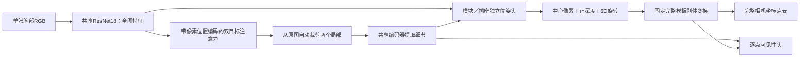

# 单张图像到完整表面点云：第一版设计与实现

后续当前推荐已改为[尖端／孔口优先的分层表示](interaction-surface-representation.md)：训练模板模块22528点、插座43008点，另有高密度局部几何参照及8891窗口。下文2048／8192是保留的第一版；网络位姿主体沿用，损失新增分层平均权重。

用户明确要求：输入图片，输出完整表面点云，表达对物体空间状态的估计，而不局限于相机直接看见的表面。

本版采用已知形状约束：图像预测每个对象的刚体位姿，再变换固定的完整表面模板。**网络代码与输出／梯度检查已实现，尚未训练；当前网络输出不能用于定位或控制。** 可操作窗口和命令见[教程](../../tutorials/image_to_complete_surface.md)。

## 目标表示

| 对象 | 默认点数 | XYZ float32 | 覆盖范围 |
| --- | ---: | ---: | --- |
| 光模块 | 2048 | 24 KiB | V4-r05的15个目标部件，含黑色端件；排除绿色挂件及假设内部阴影块 |
| 插座 | 8192 | 96 KiB | SIM-r06的113个固定外观部件，含下支架；排除等效动态触点 |

每帧两组纯XYZ合计120 KiB，法向、可见性分数等另计。模板可只存一次，逐帧保存两套4×4变换和模板版本，再按需展开点云；尚未把此压缩形式接入OMI经验池。

每点包含米制XYZ、单位法向、部件材质RGB、part_id、region_id、稳定point_id，以及来源三角形ID和重心坐标。点都从原mesh三角形表面取样，不进行凸包填孔、缩放或网格形变。完整指目标模型的全表面离散表示，包含背面和不可见面，并非每个位置都被传感器观测过。

采样分配为50%全表面、25%关键区域一、25%关键区域二。全表面部分先给每个部件基础点，再按三角形面积分配，避免小零件被大支架挤掉。模块关键区为插入端和尾部台阶／窗口；插座为孔口／通道以及白框／PCB。512、2048、8192、16384点采用固定嵌套前缀，切换密度不重新随机编号。面积采样原则与[PyTorch3D表面采样接口](https://pytorch3d.readthedocs.io/en/latest/modules/ops.html#pytorch3d.ops.sample_points_from_meshes)一致，本项目另实现区域与部件配额，不依赖PyTorch3D安装。

独立随机表面参考点到模板的最近邻P95距离（只衡量离散覆盖，不是相机位姿误差）：

| 点数 | 模块全表面 mm | 插座全表面 mm |
| ---: | ---: | ---: |
| 512 | 3.11 | 82.92 |
| 2048 | 1.62 | 10.20 |
| 8192 | 0.89 | 4.60 |
| 16384 | 0.67 | 3.17 |

模块2048点的插入端P95约1.14mm，插座8192点的孔口区域约0.82mm。插座512点在113个部件之间分配后，支架大面几乎没有足够点，明显不适合本任务。最终插接间隙／碰撞检验仍应使用原mesh或更密局部点，不能把这些数值当作物理精度认证。

## 网络与坐标

`ImageToCompleteSurface.forward(images)`只有一个动态参数：`[B,3,1080,1920]`的RGB浮点图像，范围[0,1]。不传人工ROI、位姿或点云初值；内参、鱼眼畸变和目标模板作为模型配置buffer保存，分辨率不匹配会拒绝。

全图内部缩到640×360，注意力预测两个目标中心；据此从原始分辨率图像可微裁剪224×224局部，结合全局空间特征估计位置和旋转。共享骨干采用[Torchvision ResNet-18](https://docs.pytorch.org/vision/main/models/generated/torchvision.models.resnet18)，当前`weights=None`，没有加载预训练权重。局部窗口大小目前为配置常量，尚未学习自适应边框。

旋转采用[连续6D表示](https://pytorch3d.readthedocs.io/en/latest/modules/transforms.html#pytorch3d.transforms.rotation_6d_to_matrix)，明确取前两**行**，Gram–Schmidt转换为SO(3)，并处理零向量／共线退化输入。输出位置是相机光学坐标中的米制平移；利用配置的OpenCV鱼眼模型把预测中心像素与正深度转为三维射线。它不是机械臂腕关节坐标。

每个对象输出：

- `points_m: [B,N,3]`，满足 `P_hat = R_hat P_template + t_hat`；不预测尺度或自由点偏移。
- `normals: [B,N,3]`、`T_camera_from_model: [B,4,4]`。
- `presence_logits: [B]`及`visibility_logits: [B,N]`；目前未经训练，不能当作校准置信度。
- 像素投影、自动裁剪中心和相机前方掩码，供诊断。

完整点云不因可见性低而删点；隐藏部分来自已知形状先验。存在分数用于以后处理目标缺失／出画面，阈值和校准未实现。未知新物体、几何形变、可拆件独立运动不在本版范围内。

## 监督与训练接续

已实现的主损失是固定point_id下的米制Huber表面对应损失：用可信`T_gt`变换同一模板生成完整监督，与预测点比较。源点身份稳定，因此不会只靠对称表面的低Chamfer误差忽略错面。`require_reviewed_annotation`拒绝`training_label_valid`不为布尔true的记录，单纯勾选“人工已审阅”不会自动变成训练真值。

后续训练步骤（本轮未执行）：

1. 核对本批腕部内参与坐标约定，建立带质量等级的位姿标签。当前287组没有可靠完整6D监督，粗点云配准和四点候选不能默认视为真值。
2. 先用有精确相机／位姿标签的合成数据训练，再用独立校对的真图微调；加入角度变化、部分插入、夹爪遮挡、缺失对象和光照变化。
3. 额外marker不参与目标特征。首张原型输入手工遮蔽了两个区域，不是通用marker检测器；批量训练还需可靠忽略区域和遮挡增强，并做标贴替换／去除对照，防止学到标签或遮蔽框捷径。
4. 可增加可见性／存在BCE、可见结构重投影、可靠深度一致性损失。这些真实训练损失和标签生成管线尚未接入；不能用完整模板对不完整传感器点云强行施加双向全表面匹配。
5. 按采集单元及姿态覆盖划分训练／验证，防止近邻帧泄漏；固定夹持下模块与腕部可能几乎不动，需要额外姿态变化，而不是让网络只记住固定姿态。
6. 独立评估平移／角度、插入端相对孔口误差、遮挡下失效拒绝、分数校准与真实图像回投影。隐藏表面完成度仍是模型假设，不能用模板自一致证明物理正确。

本轮运行只有前向和使用合成偏移／合成可见标签的反向检查，**优化器步数为0**。未训练真实数据、未更新OMI策略、未接入真机控制。
