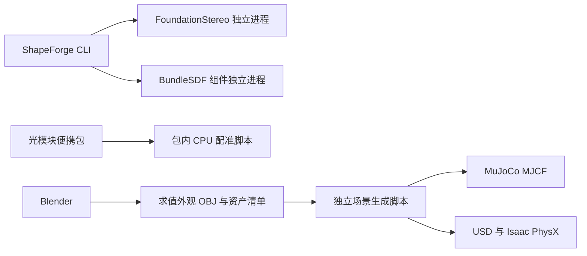

# 项目和运行时架构

## 仓库职责

`omi_shapeforge` 维护任务流程、配置、接口、配准评估和资产／仿真脚本。自有 FoundationStereo、BundleSDF 仓库维护网络、跟踪、重建及原生扩展。`omi_proj` 提供机器人资产、接口资料及已执行的离线仿真预检；本项目不调用其 ROS 或硬件控制系统。

主 CLI 只覆盖上图前两条调用，包内配准和仿真脚本是独立入口。当前没有双目结果自动转为完整重建／机器人任务的一键流水线。

## 环境和版本

主环境仅依赖标准库。两个 GPU 后端、MuJoCo／OpenUSD、Blender 及 Isaac 使用各自解释器。进程边界避免同名模块与二进制依赖串用，决定见[感知 ADR 001](../agent/perception/decisions/001-backend-processes.md)。

`backends.lock.json` 是初始化快照，不是运行时强制锁定器。`run_manifest.json` 记录实际 Git HEAD、状态、tracked diff 哈希与入口文件哈希。哈希不是补丁副本，不能恢复未提交修改；正式共享前应把算法适配提交到各自仓库。当前仍有未提交适配，资源恢复不能假定只拉取 HEAD 即可。

## 分支

`main` 保持为空，`dev` 为开发基线，后续任务在新分支进行。文档分支基于本地已验证的 `feature/optical-simulation`，以保留其代码作为文档依据；没有把这些变更合入 `main`，也未在本轮推送。不能假定远端 `dev` 已含本轮仿真和文档。

## 资源与配置

源码在工作区，运行资源由[资源接口](../agent/interfaces/local-resources.md)管理。当前配置路径选择仅有 `--config`／`OMI_SHAPEFORGE_CONFIG`；运行根路径来自 TOML。外部便携包和仿真脚本接受自己的参数，不会自动读取主配置。
