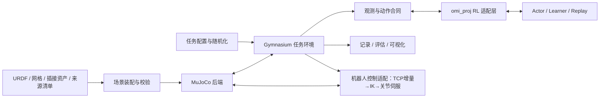

# 机械臂插接仿真与 RL 开发计划

当前验收以[仿真器专门记录](../simulation.md)及领域能力文档为准。阶段进度已推进为：

| 阶段 | 最新状态 |
| --- | --- |
| M0 | 真实URDF、IK／伺服和Gym接口已实现 |
| M1 | 固定工具附着和预插入到达可运行；实物TCP／夹爪标定及接触抓取未验收 |
| M2 | 独立SIM-r03模块／插座／触点／台面接触验证通过；完整抓取、自碰撞与实物弹性未验收 |
| M3 | 双相机、规则示范／接管、replay、BC／SAC、权重回用与续训已接通 |
| M4 | 已有小样本无接管成功：BC 7/8、第一轮RL 8/8；广范围随机化和实物迁移仍待验证 |

下文保存原M0阶段的架构／路线及当时状态。“接触关闭／未接learner”等叙述只适用于旧原型；新任务接口为 `robot_contact_insertion`，不将简化夹具当成真实URDF任务。

2026-11-21 进度补充：用户要求先贯通完整训练链，已实现[双相机预插入 → OMI 视觉 SAC](../agent/simulation/evolution/visual-training.md)，累计 300 条经验／20 次更新及续训验证。M1 采用显式固定附着假设，M3 已有按回合交替采集／训练的小闭环；M2 接触及实际工具／相机标定仍未完成。以下保留最初 M0 路线和难度估计，原“未接 learner”描述已由新链路部分推进。

当前优先级是**先搭带真实机械臂模型的软件骨架，再逐步补齐接触与学习**。用户明确第一版也要使用已有机械臂 URDF；纯笛卡尔夹持体只保留为自动化接口夹具，不作为主场景。

## 当前已经落地

- 从完整厂商 URDF 导入双臂及夹爪：27 个 link、14 个机械臂旋转关节、4 个滑动指关节、2 个 mimic 等式。
- 保留原 URDF 与网格；解析 package 路径，仅移除两处零体积 TCP 显示网格，坐标架保留。
- MuJoCo 场景包含机械臂、圆桌、完整插接座 r04 和 V3 参考外观，150 个光模块／插接座可视分件已加入。
- `RobotReachEnv` 提供 6 维末端增量 → 阻尼最小二乘 IK → 7 关节位置伺服 → Gymnasium 观测／奖励／回合结束。
- 真实 URDF 的小幅到达检查在两次不同重置下通过，TCP 误差约 17.4 mm → 2.65 mm，31 个控制步。它是脚本控制检查，没有训练策略。
- 保留独立 `SimpleInsertionEnv` 作为接口回归夹具，验证简化插入、偏置碰壁不能误报成功、超时和动作非法输入。

当前机械臂场景**关闭接触计算**，用假设位置伺服和重力补偿验证软件链路；插接座和光模块是静态参考，尚未与夹爪建立抓取关系。使用 URDF TCP 坐标架，不把它冒称为已经校准的实际工具中心。机器人插入任务入口会明确报未实现，不会悄悄替换成简化夹具。

## 架构与职责

| 层 | 当前位置 | 职责及边界 |
| --- | --- | --- |
| 资产与版本 | `manifests/robot_assets.json`、`socket_assets.json` | 来源、版本和假设；模型本体在外部目录 |
| URDF 场景装配 | `src/omi_shapeforge/sim/robot_scene.py` | 完整机器人导入、保留关节/TCP、引用插接资产；不改源 URDF |
| 机器人与控制适配 | `sim/robot_env.py` | TCP 增量、IK、关节目标、实际状态读取；只连接仿真 |
| 任务入口 | `sim/factory.py` | 显式选择 `robot_reach`、`insertion_proxy`；`robot_insertion` 尚未开放 |
| 简化回归夹具 | `sim/config.py`、`scene.py`、`insertion_env.py` | 快速检查 Gym 与回合语义，不代替机械臂任务 |
| RL 算法与数据 | `omi_proj` | 保留已有 Actor/Learner/Replay；通过新适配层接仿真，当前未直接接通 |
| 运行与证据 | `sim/smoke.py`、外部 run | 观测/请求动作/命令/实际运动分开记录，保存复现参数和图像 |

ShapeForge 的标准库控制环境仍保持轻量；模拟依赖由 `simulation` 可选依赖组声明，当前使用已有 `/data/omi_runtime/envs/omi_assets`。本轮没有安装训练依赖或修改 omi_proj。

## 接口先约定清楚

**动作：**6 维归一化增量，平移每轴上限 `1 mm / √3`、旋转每轴 `1° / √3`，10 Hz。机械臂原型采用 MuJoCo 世界坐标中的 TCP 增量；它不是已经完成 SDK ABC／机器人基坐标映射的真机命令。请求动作、IK 关节目标、实际 TCP 位移分别记录。

**观测：**当前 `robot_reach` 为 `state[14]`、`tcp_pose[7]`、`goal_error[6]`，只供状态型调试。`insertion_proxy` 的状态与目标字段另有独立合同。二者都不冒用现有 HIL 的十帧 RGB／腕部图像／触觉／掩码合同。

**回合：**成功字段单独使用 `info.is_success`，不能把所有 `terminated=True` 都算成功；失败可以终止，时限应截断。插入成功将另定义为深度、横向／角度误差、接触与稳定保持共同满足，而不是图像看起来已经穿入。

**框架衔接：**已有 `sim_train.py` 是 7 维关节动作的到达任务；在线 HIL 则是 6 维动作加多模态历史。需要显式环境工厂和观测／动作适配，不能直接加载旧 checkpoint 或把新 transition 写进旧 replay。真值状态可先用于仿真调试，但不得混称为视觉策略已完成 sim-to-real。

## 分阶段实施与难度

工作量是熟悉现有仓库、资源可用时的粗估，不包含等待标定资料或现场验证。

| 阶段 | 范围 | 难度／粗估 | 验收 |
| --- | --- | --- | --- |
| M0 架构与真实 URDF 小闭环 | 当前已实现的导入、场景、6D→IK→伺服、状态 Gym | 中；原型已完成 | 模型编译、两个重置种子的到达、无效动作拒绝、非主动臂保持、渲染 |
| M1 工具与预插入到达 | 主动臂身份、实际夹爪/TCP、抓取变换、工作台布局、关节与指限位审查 | 中高；约 1–3 个工作日 | 实际模型夹持模块，能到孔口前的目标位姿；夹爪不瞬移 |
| M2 接触插入任务 | 开启并审查自碰撞／台面／夹具碰撞，保留孔的凹结构，抓取约束、弹片代理及失效判定 | 高；约 2–5 个工作日，精度可能更久 | 正常路径通过、偏心/倾斜被阻挡、无明显穿模；分清刚体与弹性假设 |
| M3 接现有 RL 框架 | 环境工厂、replay 字段与动作来源、先状态 SAC 冒烟，再相机与历史观测 | 中高；约 2–5 个工作日 | reset/step/结束语义正确，buffer 样本可读，learner 更新、评估独立 |
| M4 策略与真实性 | 多种初态、尺寸/位姿/摩擦随机化、视觉策略、接触校准与迁移评估 | 高；周级迭代 | 多种子成功率、失败类型与干预统计；不以单次脚本成功代替学习效果 |

先做 M1 的“机械臂夹持模块到孔口前”，无需第一天追求完整弹性插入。M0 的代理夹具继续跑测试，但主线始终使用机械臂。

## 当前需要审查的模型项

- 厂商 URDF 的指关节 velocity 声明为 0，不能直接据此决定控制速度。
- 右指关节存在较大的局部坐标偏移，与网格／惯性坐标有补偿关系；应检查组合后的世界几何，不能只按单个数值自动改掉。
- 当前选择 URDF L 臂对应旧文档 A 臂方向，但硬件身份、工具安装和 TCP 仍需核对。
- 位置伺服增益、重力补偿、惯量和碰撞未做物理校准；当前禁用接触只是软件阶段的显式设置。
- 高度方面：V3 平段 7.84 mm、基本通道 9.60 mm 是模型值，孔口弹片和推断内件使实际余量更小。暂不能确认高度完全正确，更不能据此认证 RL 插入。

## 当前产物与下一步

- [真实 URDF 场景预览](/data/omi_runtime/runs/robot_urdf_mvp_20261120T090059Z/robot_final.png)
- [导入与来源记录](/data/omi_runtime/runs/robot_urdf_mvp_20261120T090059Z/scene/robot_manifest.json)
- [机械臂小幅到达结果](/data/omi_runtime/runs/robot_urdf_mvp_20261120T090059Z/reach_smoke.json)
- [接口校验](/data/omi_runtime/runs/robot_urdf_mvp_20261120T090059Z/interface_validation.json)

下一工程项：核对工具坐标，建立 `tool_to_module` 和 `socket_to_world`，把静态模块参考改为与夹爪绑定的仿真对象；然后完成机械臂预插入到达，而非立即开展长时间 RL 训练。启动与重建命令见[机械臂原型教程](../../tutorials/robot_sim_mvp.md)。
